# Canadian Sports Atlas

An interactive map of Canadian professional sports: every NHL, NBA, MLB, MLS, CFL, CPL, NLL, CEBL, PWHL, WNBA, NSL and Call of Duty League team that has played in Canada, current or former, with its venues, championships and history. Built with the [Astryx](https://github.com/facebook/astryx) design system.

**Live site: [latxh.github.io/canada-sports-map](https://latxh.github.io/canada-sports-map/)**

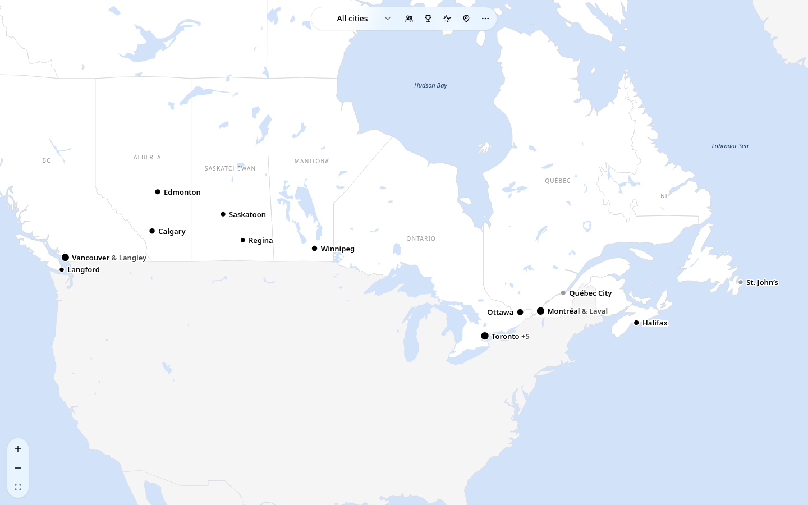

## Features

### The map

- **Canada, full screen.** The map opens on the band of sports cities across southern Canada, with the rest of the world filled in around it. Zoom in for a finer coastline, rivers, lakes, nearby towns and the names of seas, lakes, mountain ranges and islands.
- **City dots.** Each sports city is a solid dot with its name: dark for cities with active teams, light grey for cities whose teams are all gone, blue (with a pulse) when selected. Nearby cities merge into one dot until you zoom in.
- **League filter.** One dropdown shows all cities or a single league. With a league picked, a city that has one team in it opens straight to that team.
- **Logo takeover.** When a team is the only current Canadian team in its league (the Raptors, the Blue Jays, the Tempo), its page fills Canada with its logo.
- **Share links with their own previews.** Every team, city, league and map layer has a share link (for example [`/team/toronto-raptors/`](https://latxh.github.io/canada-sports-map/team/toronto-raptors/)) with its own preview card on X, Reddit, iMessage, Discord and Slack. Share hands out the link for what you're looking at (the native share sheet on phones); the league, layer and pin are also kept in the URL.

| City panel with a 3D venue | Logo takeover |
| --- | --- |
| 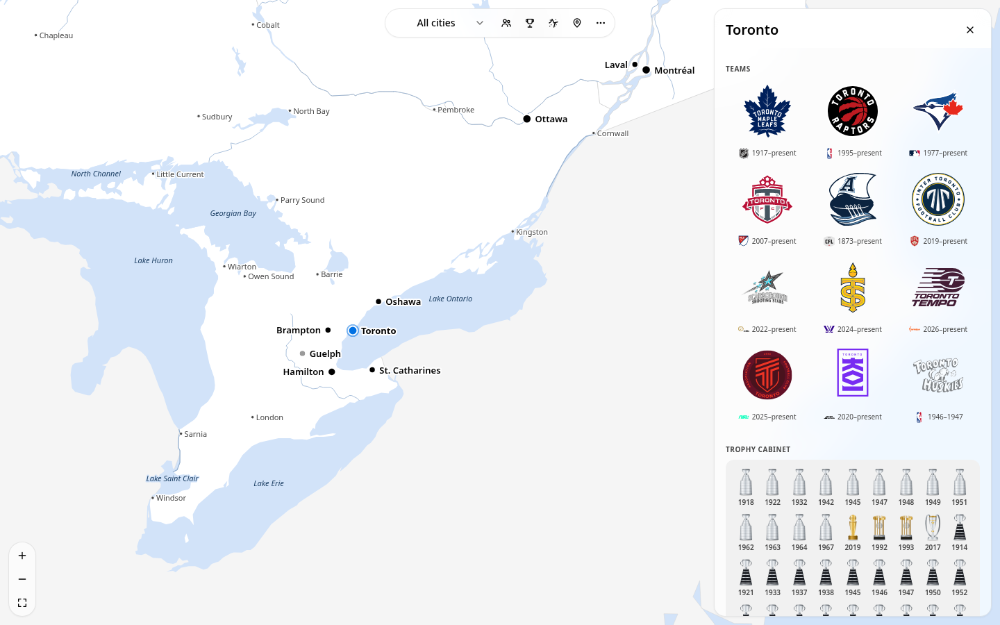 | 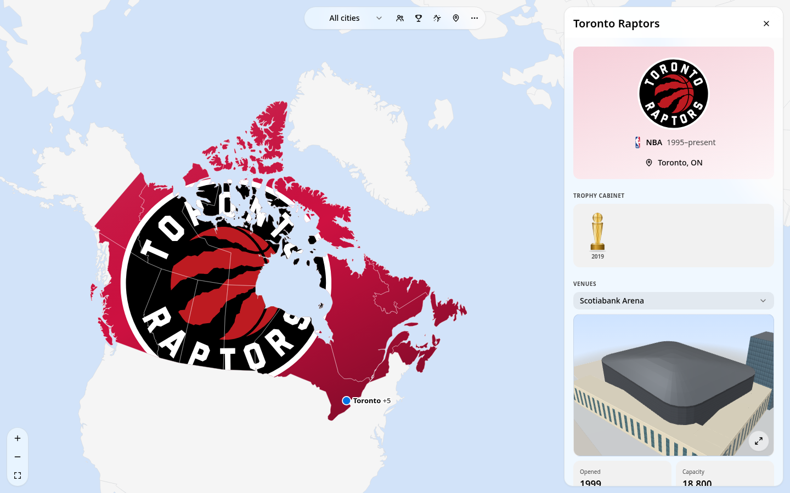 |

### Map layers

Four round toggles sit beside the league filter; one is on at a time. The first three are living, ordered-dither patterns that ripple out from each city and twinkle (they hold still if you prefer reduced motion), drawn as part of the map so they move with it as you pan and zoom.

- **Population**: every one of Canada's 152 metro areas and agglomerations, sized by its 2021 Census population.
- **Championships**: gold around each city, sized by the titles its teams have won, with the count.
- **Closest team**: every spot in Canada coloured by its nearest team. Hover or tap for the team and the distance.
- **Drop a pin**: tap anywhere (or use your location) and arcs fly to every city on the map, coloured by distance (green nearby, through yellow, to red from about 4,500 km away, so a pin far from Canada turns them all orange and red), with the nearest cities and the farthest one listed in kilometres.

| Closest team (NHL) | Population |
| --- | --- |
| 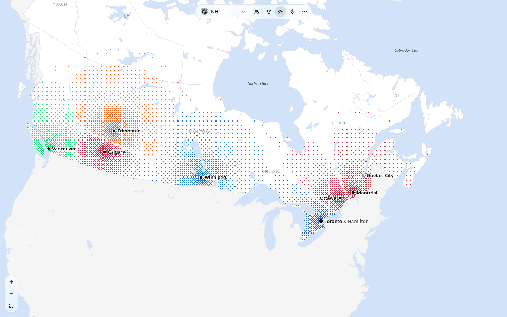 | 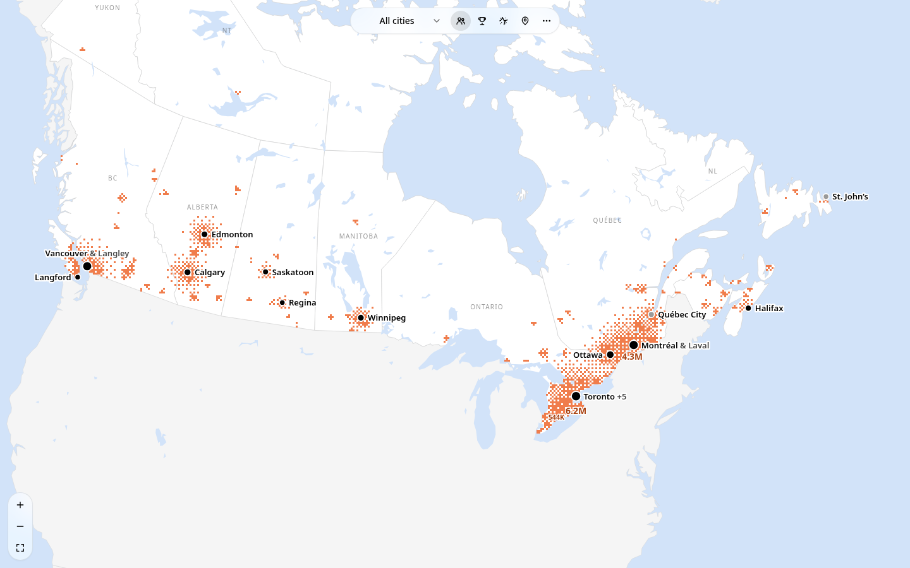 |
| **Championships** | **Drop a pin** |
| 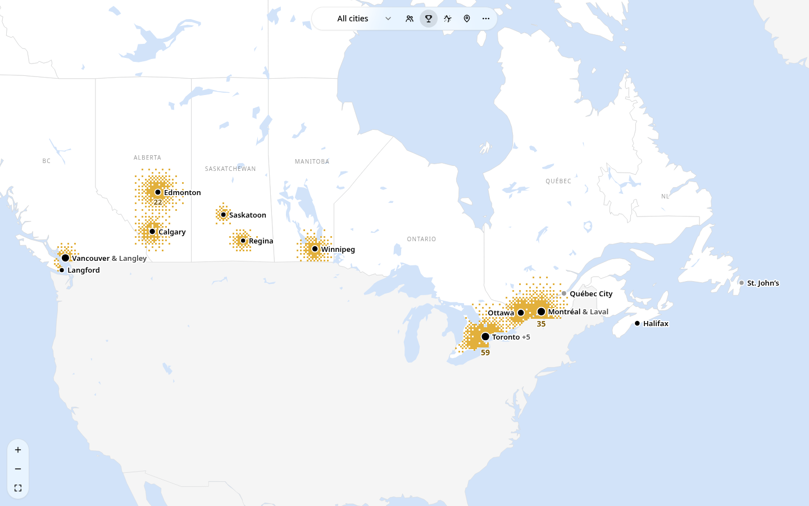 | 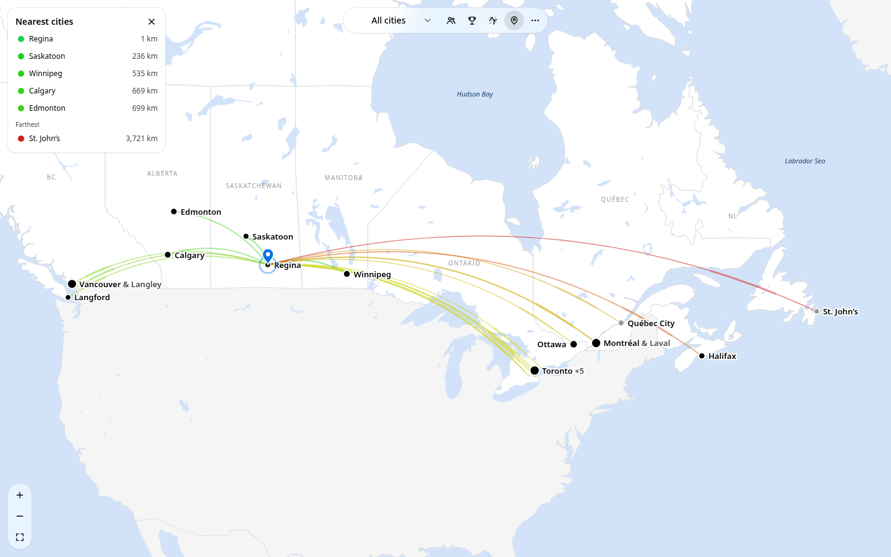 |

### City and team panels

- **City**: its teams as logo tiles (league and years underneath), a trophy cabinet with one trophy per title, and its active venues in a dropdown, each with a 3D model (or a photo) and cards for year opened, capacity, surface and roof.
- **Team**: a hero card, the trophy cabinet, every venue the team has called home, carousels of logos, uniforms and playing surfaces through the years (from SportsLogos.net, used with permission), a photo carousel, and links to Wikipedia and logo archives. Opened from a city, it has a back button to that city.
- **Trophies**: original illustrations of all twelve championship trophies, drawn from photos of the real ones.

| Team page | Uniforms, rinks and photos |
| --- | --- |
| 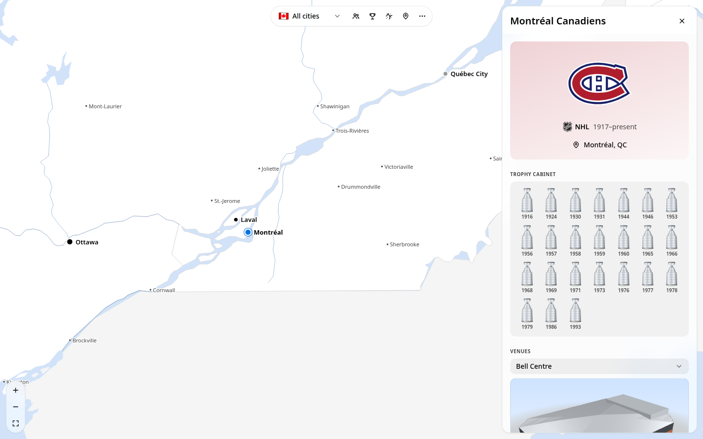 | 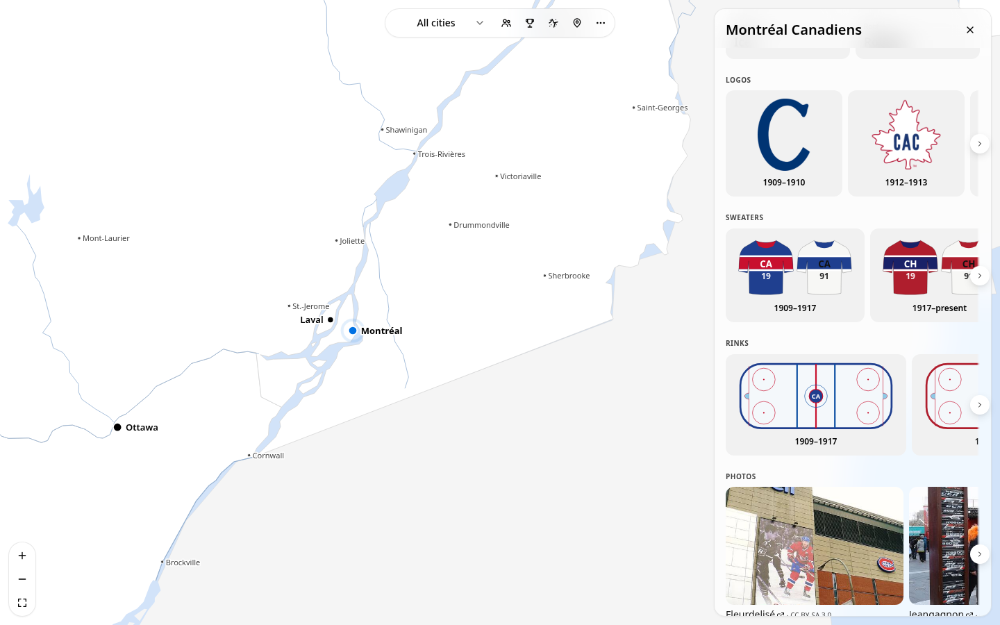 |

### 3D venues

Each of the 24 stadiums and arenas that NHL, NBA, MLB, MLS, CFL and CPL teams play in today has its own hand-built, low-poly model, drawn to scale from OpenStreetMap footprints and reference photos. Rogers Centre's roof opens and closes, BC Place's roof gathers under its 36 masts, and fields switch markings for the sport you're looking at. Models open full screen. On phones, a pre-rendered still shows first and the 3D model loads when you tap **View in 3D**; desktops load it as soon as the card scrolls into view, and it only animates while it's on screen.

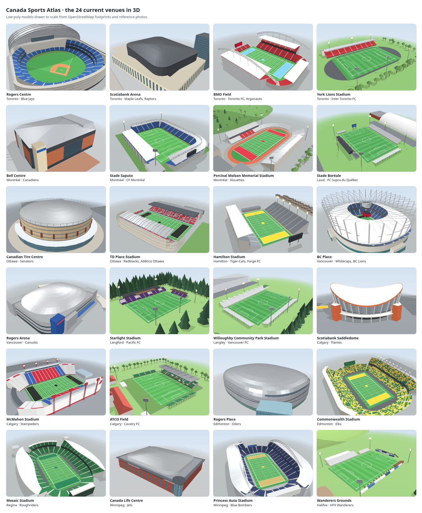

### Link-preview cards

Each share link shows a card made for it: a team's logo, league, years and trophies beside its territory on the map; a city's teams around a glow on its spot; a league's Canadian teams and the closest-team map for that league; or a full map for each layer.

| Team | City | League |
| --- | --- | --- |
| 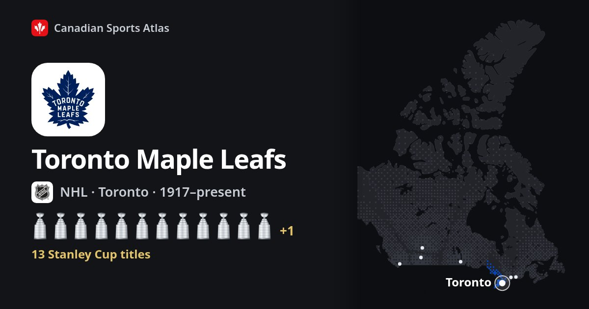 | 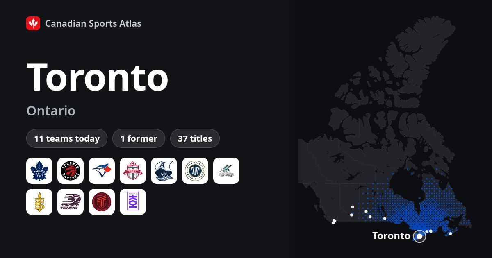 | 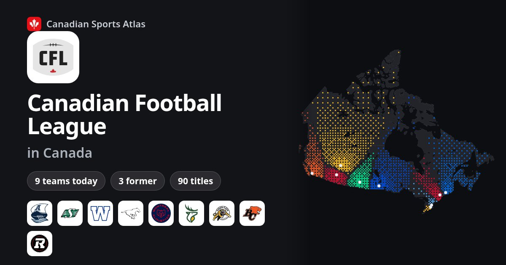 |

### Everywhere

Light and dark mode, a draggable bottom sheet on phones, keyboard-accessible map markers, and no axe-core violations.

| Dark mode | Phone | Phone, closest team |
| --- | --- | --- |
| 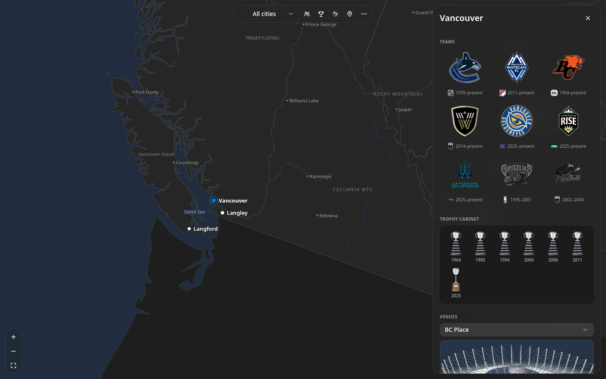 | 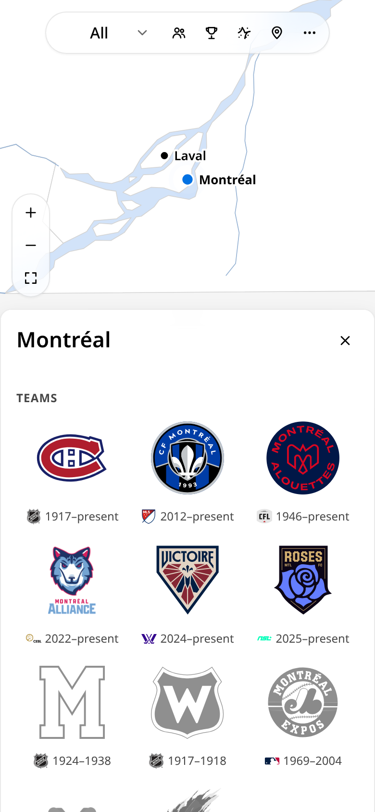 | 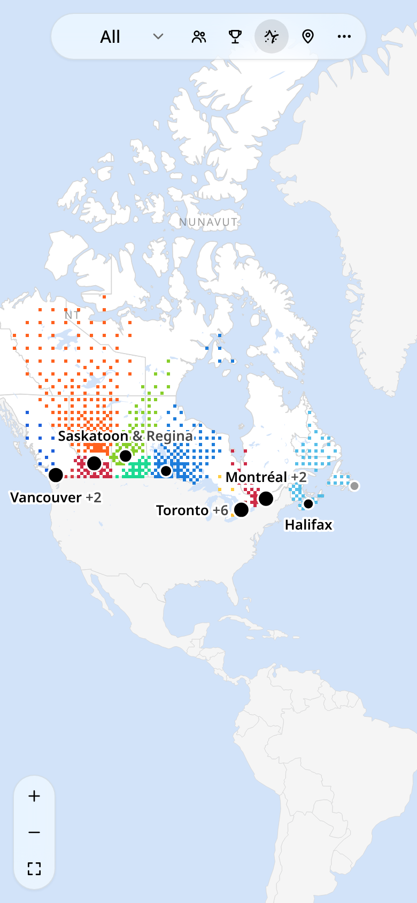 |

## Coverage

The data was reviewed in November 2026 and covers 83 teams in 20 cities:

| League | Active | Former |
| --- | --- | --- |
| NHL | Maple Leafs, Canadiens, Senators, Jets, Flames, Oilers, Canucks | Nordiques, Jets (1972–96), Senators (1917–34), Maroons, Tigers, Wanderers, Bulldogs |
| NBA | Raptors | Grizzlies, Huskies |
| MLB | Blue Jays | Expos |
| MLS | Toronto FC, Whitecaps FC, CF Montréal | none |
| CFL | Lions, Stampeders, Elks, Roughriders, Blue Bombers, Tiger-Cats, Argonauts, Redblacks, Alouettes | Rough Riders, Renegades, Concordes |
| CPL | Forge, Cavalry, Pacific, Inter Toronto, HFX Wanderers, Atlético Ottawa, Vancouver FC, Supra du Québec | FC Edmonton, Valour |
| NLL | Rock, Roughnecks, Rush, Warriors, Thunderbirds, FireWolves | Edmonton Rush, Rebel, Express, Ravens, Black Bears |
| CEBL | Sea Bears, River Lions, Stingers, Mamba, Shooting Stars, Honey Badgers, Surge, Bandits, BlackJacks, Alliance | Hamilton Honey Badgers, Nighthawks, Growlers |
| PWHL | Victoire, Sceptres, Charge, Goldeneyes, PWHL Hamilton | none |
| WNBA | Tempo | none |
| NSL | Rise, AFC Toronto, Roses, Rapid, Wild, Tides, Ember (from 2027) | none |
| CDL | Toronto KOI (formerly Ultra), Vancouver Surge | none |

## Getting started

```bash
npm install
npm run dev        # http://localhost:5173
npm test           # dataset integrity tests
npm run build      # type-check + production build into dist/
```

Requires Node 22.13 or later.

## Project layout

```
src/
  data/            # typed dataset: leagues, cities, venues, teams/*.ts, population, media (+ integrity tests)
  data/geo/        # simplified Natural Earth TopoJSON (built by scripts/build-geo.mjs)
  components/      # SportsMap (d3-geo + d3-zoom), DitherLayer, map tools, panels, credits
  visuals/         # original SVG illustrations: trophies, badges, uniforms, playing surfaces
  three/           # 3D: kit/ (low-poly parts), models/ (one per current venue), viewer (lazy-loaded)
  og/              # share links: manifest (paths, titles, descriptions) and the ?og= preview cards
  lib/analytics.ts # Google Analytics page views and events
public/
  stills/          # pre-rendered stills of the 3D venue models (scripts/render-stills.mjs)
  og/              # rendered preview cards, one per share link (scripts/render-og.mjs)
  logos/           # current team and league logos (from Wikipedia)
  media/           # historical logos and photos (from Wikipedia and Wikimedia Commons)
```

### Editing data

Each team is one object in `src/data/teams/*.ts`, typed by `src/data/types.ts`. Add a venue to `src/data/venues.ts` and a city to `src/data/cities.ts`, then run `npm test`: it checks that every reference resolves, that years and statuses agree, that well-known title counts are right, and that every logo, photo, preview card and venue still exists.

The app's data holds only what it shows. The written research behind it (team summaries, milestones, honours and fates, venue facts, city blurbs, colour names and notes on each era's logo, jersey and playing surface) lives in `research/notes.json`, which isn't bundled; the tests check it still has a fate for every former team and a name for every colour.

### Editing 3D models

Each current venue has a model function in `src/three/models/<city>.ts`, built from the parts in `src/three/kit/`. Sizes are in metres. When a team moves into a new home, add its model there and its id to `src/three/modelIds.ts`; `npm test` checks that exactly the venues of current teams in those six leagues have a model, and that each builds within the triangle and draw-call budget. Then re-render the stills (one per venue and colour scheme), which `npm test` also checks:

```bash
npm run dev                                         # in another terminal
npm i --no-save playwright && npx playwright install chromium
npm run stills                                      # needs ImageMagick for the WebP conversion
```

### Rebuilding the map and media

- `scripts/build-geo.mjs` explains how to download the Natural Earth source files and regenerate the base map and the zoomed-in detail layer.
- `scripts/fetch-sportslogos.py` downloads each team's logo, uniform and playing-surface history from SportsLogos.net (with permission; slowly, with every page cached), and `scripts/build-sportslogos.py` turns it into `public/sportslogos/` and `src/data/sportslogos.ts`.
- `scripts/fetch-media.py` downloads historical logos and freely licensed photos from Wikipedia and Wikimedia Commons, and `scripts/build-media.py` turns them into `public/media/` and `src/data/media.ts`.

### Share links and preview cards

`src/og/manifest.ts` lists every share link. On each build, a small Vite plugin writes a page for each one (`team/<id>/`, `city/<id>/`, `league/<id>/`, `view/<layer>/`) with its preview tags, which sends visitors on to the app (passing through any `utm_` parameters). Preview bots ignore `?` and `#`, which is why these are real paths.

The cards are rendered from the app: open `?og=list` in the dev server to see them all, or `?og=team:toronto-raptors` for one. After changing a card or adding a team, city or league, re-render them (`npm test` fails when one is missing):

```bash
npm run dev                                         # in another terminal
npm i --no-save playwright && npx playwright install chromium
npm run og                                          # all cards, or: npm run og -- http://localhost:5173/ team:
```

### Analytics

`index.html` loads Google Analytics (GA4) on the live site only (not on localhost or for `?og=` card renders). The app sends a page view per city, team, league and layer, under the same paths as the share links, plus events for the league filter (`select_league`), layer toggles (`toggle_layer`), pin drops (`drop_pin`) and sharing (`share`). In the GA web stream, "Page changes based on browser history events" is off so views aren't counted twice. Analytics cookies are off by default in the EEA, UK, Switzerland and Quebec, and no advertising features are used.

### Deploying

`.github/workflows/ci.yml` type-checks, tests and builds every push and pull request once; on `main`, a second job publishes that same build to GitHub Pages. Every run also uploads a relative-path preview build (the run's Artifacts → `preview-build`).

## Credits

- **[Wikipedia](https://en.wikipedia.org/)**: team, venue and championship facts, paraphrased (CC BY-SA 4.0). Every team and venue links to its article.
- **Logos**: the files each team's and league's Wikipedia article uses. `src/data/logos.ts` and `src/data/media.ts` record each file's page and licence. Most are non-free trademarks, used on Wikipedia under fair use.
- **[Wikimedia Commons](https://commons.wikimedia.org/)**: team and venue photos, all freely licensed and credited under each photo and in the app's Credits.
- **[Statistics Canada](https://www150.statcan.gc.ca/t1/tbl1/en/tv.action?pid=9810000301)**: 2021 Census population for the Population layer.
- **[Natural Earth](https://www.naturalearthdata.com/)**: countries, provinces, coastlines, lakes, rivers, towns and geography names (public domain).
- **[OpenStreetMap](https://www.openstreetmap.org/copyright)**: venue footprints and dimensions used as references for the 3D models (© OpenStreetMap contributors, ODbL).
- **[SportsLogos.net](https://www.sportslogos.net/)**: logo, uniform and playing-surface history images (`public/sportslogos/`), used with permission. Opening any image shows its source link, the Credits list SportsLogos.net, and each team links to its full history there.
- **[Google Analytics](https://marketingplatform.google.com/about/analytics/)**: visit counts (see Analytics above).
- **[Astryx](https://github.com/facebook/astryx)**, **[three.js](https://threejs.org/)** / **[React Three Fiber](https://r3f.docs.pmnd.rs/)**, **[d3](https://d3js.org/)**, **[TopoJSON](https://github.com/topojson/topojson)**.

Trophies are original illustrations, and so are the badges, uniforms and playing surfaces for teams SportsLogos.net doesn't cover. Team names, logos and uniforms are trademarks of their owners. This is an unofficial fan project, not affiliated with or endorsed by any league or team.
