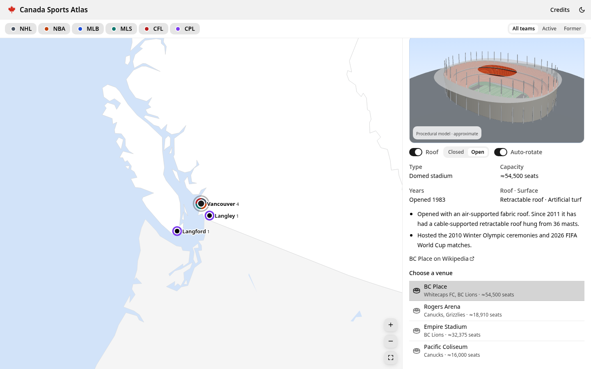
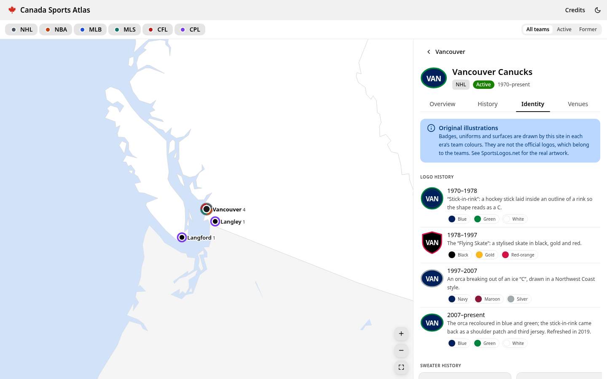

# Canada Sports Atlas

An interactive map of Canadian professional sports. Every NHL, NBA, MLB, MLS, CFL, CPL, NLL, CEBL, PWHL, WNBA and NSL team that has played in Canada, current or former, is on it, along with its venues, championships and identity history. Built with the [Astryx](https://github.com/facebook/astryx) design system.


## Features

- **Map of Canada.** The map fills the screen and opens framed on the band of sports cities across southern Canada, with the rest of the world filled in around it. Zoom in and Canada gains a finer coastline, rivers and lakes, nearby towns, and the names of seas, lakes, mountain ranges and islands. Closing a panel returns to the view you jumped from. The selected city is a blue dot with a blue pulse. Each sports city is a ring with its name: a solid outline for cities with active teams, a dashed one for cities that only had teams in the past, filled in when selected. The ring and the name are one control: hovering either lifts the ring and underlines the name. Nearby cities (Montréal and Laval, Vancouver and its suburbs, Toronto and Hamilton) merge into a cluster until you zoom in. Pan, zoom, or use the controls to fit all of Canada.
- **Floating controls.** Frosted-glass buttons float over the map: the league picker and menu in a pill centred at the top (the league list opens below it), and round zoom buttons bottom left.
- **Floating panel.** Click a city to open its details in a panel that floats over the right side of the map. The panel header is the city or team name with a close button.
- **Menu.** Appearance (light, dark or system), Share (copies the current view's link), Credits, and a link to the author.
- **City overview.** A trophy shelf of the city's titles, its active and former teams as logo tiles, a short history, and its venues, with a 3D model of each one a current team plays in.
- **Trophy cabinet.** Every team page shows one trophy per championship with its year: Stanley Cup, Larry O'Brien Trophy, Commissioner's Trophy, Philip F. Anschutz Trophy (MLS Cup), Grey Cup, North Star Cup, NLL Cup, CEBL championship trophy, Walter Cup, WNBA championship trophy and Diana B. Matheson Cup. The trophies are original illustrations.
- **League filter.** A fixed-width dropdown shows all leagues or just one (NHL, NBA, MLB, MLS, CFL, CPL, NLL, CEBL, PWHL, WNBA or NSL). The choice is kept in the URL so a view can be shared.
- **Logo takeover.** When a team is the only current Canadian team in its league (the Raptors, the Blue Jays, the Tempo), filtering to its league or opening its page fills the map of Canada with its logo.
- **Official logos.** Team and league logos come from the files their Wikipedia articles use (see Credits).
- **Team pages.**
  - *Overview*: summary, what happened to the team, colours, every championship year and other honours.
  - *History*: a timeline of milestones.
  - *Identity*: logo history, home and away uniforms for each era, and the rink, court, field or pitch for each era.
  - *Venues*: every home the team has had, with a 3D model of the current one.
- **3D models of all 24 current venues.** Every stadium and arena a current team plays in has its own hand-built, low-poly model, drawn to real dimensions from OpenStreetMap footprints and reference photos, so models are to scale with each other: Rogers Centre's roof panels slide and swing open, BC Place's centre gathers into its hub under 36 masts, the Saddledome keeps its saddle, TD Place its timber veil, Princess Auto Stadium its arches and Wanderers Grounds its shipping containers. Fields switch markings for the sport you are looking at (for example soccer or CFL at BMO Field). Models can be viewed full screen; former venues, and venues used only by the NLL, CEBL, PWHL, WNBA and NSL, are described but not modelled yet.
- **Works on phones.** On small screens the details panel becomes a draggable bottom sheet.
- Keyboard-accessible map markers and no violations from axe-core.

| City overview | Team page with trophy cabinet | Mobile |
| --- | --- | --- |
|  |  |  |

### Stadium models


## Coverage

The dataset was reviewed in November 2026 and covers 80 teams in 20 cities:

| League | Active | Former |
| --- | --- | --- |
| NHL | Maple Leafs, Canadiens, Senators, Jets, Flames, Oilers, Canucks | Nordiques, Jets (1972–96), Senators (1917–34), Maroons, Tigers, Wanderers, Bulldogs |
| NBA | Raptors | Grizzlies, Huskies |
| MLB | Blue Jays | Expos |
| MLS | Toronto FC, Whitecaps FC, CF Montréal | none |
| CFL | Lions, Stampeders, Elks, Roughriders, Blue Bombers, Tiger-Cats, Argonauts, Redblacks, Alouettes | Rough Riders, Renegades, Concordes |
| CPL | Forge, Cavalry, Pacific, Inter Toronto, HFX Wanderers, Atlético Ottawa, Vancouver FC, Supra du Québec | FC Edmonton, Valour |
| NLL | Rock, Roughnecks, Rush, Warriors, Thunderbirds, FireWolves | Edmonton Rush, Rebel, Express, Ravens, Black Bears |
| CEBL | Sea Bears, River Lions, Stingers, Mamba, Shooting Stars, Honey Badgers, Surge, Bandits, BlackJacks, Alliance | Hamilton Honey Badgers, Nighthawks, Growlers |
| PWHL | Victoire, Sceptres, Charge, Goldeneyes, PWHL Hamilton | none |
| WNBA | Tempo | none |
| NSL | Rise, AFC Toronto, Roses, Rapid, Wild, Tides | none |

## Getting started

```bash
npm install
npm run dev        # http://localhost:5173
npm test           # dataset integrity tests
npm run build      # type-check + production build into dist/
```

Requires Node 22.13 or later.

## Project layout

```
src/
  data/            # typed dataset: leagues, cities, venues, teams/*.ts (+ integrity tests)
  data/geo/        # simplified Natural Earth TopoJSON (built by scripts/build-geo.mjs)
  components/      # SportsMap (d3-geo + d3-zoom), panels, filters, credits
  visuals/         # original SVG illustrations: badges, uniforms, playing surfaces
  three/           # 3D: kit/ (low-poly parts), models/ (one per current venue), viewer (lazy-loaded)
```

### Editing data

Each team is one object in `src/data/teams/*.ts`, typed by `src/data/types.ts`. Add a venue to `src/data/venues.ts` and a city to `src/data/cities.ts`. Then run `npm test`: the tests check that every reference resolves, that years and statuses agree, and that well-known title counts are right.

### Editing 3D models

Each current venue has a model function in `src/three/models/<city>.ts`, built from the parts in `src/three/kit/` (stepped stands, bowls, canopies, roof shells, trusses, masts, light poles, trees). Sizes are in metres. When a team moves into a new home, add its model there and its id to `src/three/modelIds.ts`; `npm test` checks that exactly the venues of current teams have a model and that each one builds within the triangle and draw-call budget.

### Rebuilding the map

`scripts/build-geo.mjs` explains how to download the Natural Earth source files and regenerate `src/data/geo/canada.topo.json` (base map) and `src/data/geo/canada-detail.topo.json` (the zoomed-in layer, loaded after the map is up).

### Deploying

`.github/workflows/pages.yml` publishes the site to GitHub Pages when you run it manually. Pages needs a public repository (or a paid plan for private ones). Turn it on under **Settings → Pages → Source: GitHub Actions**.

## Credits

- **[Wikipedia](https://en.wikipedia.org/)**: team, venue and championship facts, paraphrased (CC BY-SA 4.0). Every team and venue links to its article.
- **Logos**: `public/logos/` holds the logo files used on each team's and league's Wikipedia article. `src/data/logos.ts` records each file page and its licence. Most are non-free trademarks, used on Wikipedia under fair use.
- **[SportsLogos.net](https://www.sportslogos.net/)**: reference for logo and uniform history. The app links to its league archives. SportsLogos.net asks automated tools not to collect its content, so no images or data were copied from it.
- **[Natural Earth](https://www.naturalearthdata.com/)**: countries, provinces, coastlines, lakes, rivers, towns and geography names (public domain).
- **[OpenStreetMap](https://www.openstreetmap.org/copyright)**: venue footprints, stand layouts and dimensions used as references for the 3D models (© OpenStreetMap contributors, ODbL).
- **[Wikimedia Commons](https://commons.wikimedia.org/)** photos: used only as visual references for the 3D models; none are included.
- **[Astryx](https://github.com/facebook/astryx)**, **[three.js](https://threejs.org/)** / **[React Three Fiber](https://r3f.docs.pmnd.rs/)**, **[d3](https://d3js.org/)**, **[TopoJSON](https://github.com/topojson/topojson)**.

Where there's no official logo for an era, the badge is an original illustration in that era's colours, and so are the uniforms and playing surfaces. Making this repository public would mean publishing official team logos, which are trademarks of their owners. Team names, logos and uniforms are trademarks of their owners. This is an unofficial fan project and is not affiliated with any league or team.
