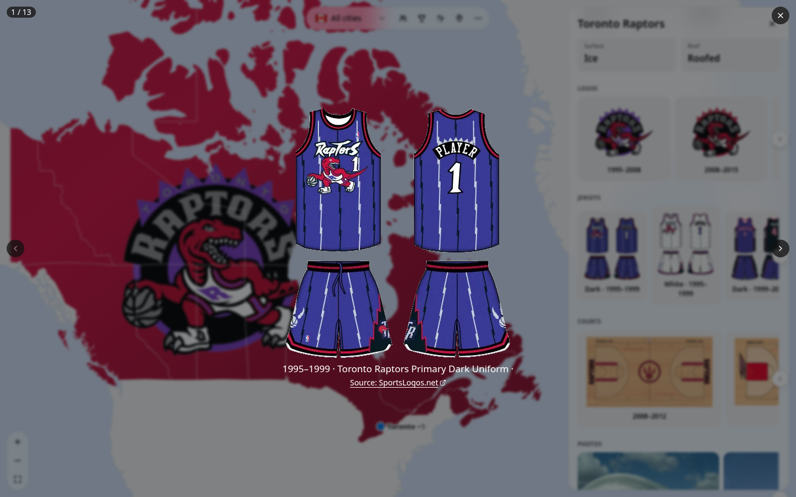
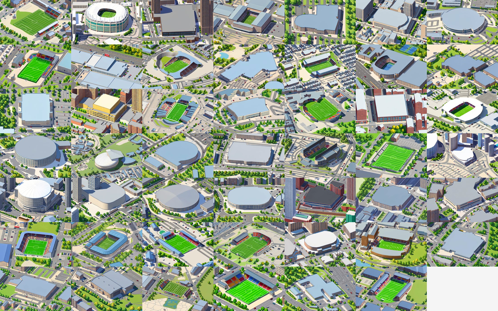
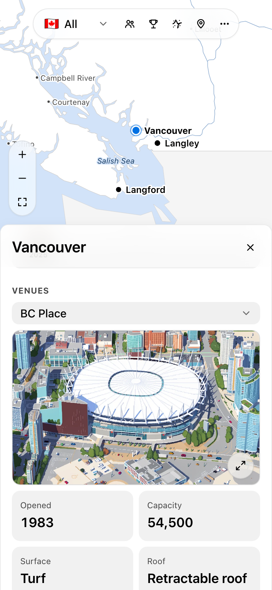

# Canadian Sports Atlas

An interactive map of Canadian professional sports: every NHL, NBA, MLB, MLS, CFL, CPL, NLL, CEBL, PWHL, WNBA, NSL and Call of Duty League team that has played in Canada, current or former, with its venues, championships and history. Built with the [Astryx](https://github.com/facebook/astryx) design system.

**Live site: [latxh.github.io/canada-sports-map](https://latxh.github.io/canada-sports-map/)**


## Features

### The map

- **Canada on a familiar web map.** The map opens on the band of sports cities across southern Canada, with the rest of the world around it. Zoom in for a finer coastline, rivers, lakes, nearby towns and the names of seas, lakes, mountain ranges and islands; zoom out to see the whole world.
- **City dots.** Each sports city is a dot with its name: dark for cities with active teams, light grey for cities whose teams are all gone, blue with a pulse when selected. Nearby cities merge into one dot until you zoom in.
- **League filter.** One dropdown shows all cities or a single league. With a league picked, a city with one team in it opens straight to that team.
- **Logo takeover.** When a team is the only current Canadian team in its league, filtering to that league or opening its page fills mainland Canada with its logo (the Raptors get their original 1995 logo).
- **Share links with their own previews.** Every team, city, league and map layer has its own link (for example [`/team/toronto-raptors/`](https://latxh.github.io/canada-sports-map/team/toronto-raptors/)) with a preview card made for it on X, Reddit, iMessage, Discord and Slack. Share hands out the link for what you're looking at, using the native share sheet on phones.

| City panel | Logo takeover |
| --- | --- |
|  |  |

### Map layers

Four round toggles sit beside the league filter, one on at a time. The first three are animated dot patterns that ripple out from each city and twinkle, drawn as part of the map so they move with it, with the dots staying the same small size at every zoom. They hold still if you prefer reduced motion.

- **Population**: all 152 of Canada's metro areas and agglomerations, sized by 2021 Census population.
- **Championships**: gold around each city, sized by the titles its teams have won.
- **Closest team**: every spot in Canada coloured by its nearest team. Hover or tap for the team and the distance.
- **Drop a pin**: tap anywhere, or use your location, and arcs fly to every city on the map. They're coloured by real distance: green nearby, through yellow, to red from about 4,500 km, so a pin far from Canada turns them all red. A card lists the nearest cities and the farthest one.

| Closest team (NHL) | Population |
| --- | --- |
|  |  |
| **Championships** | **Drop a pin** |
|  |  |

### City and team panels

- **City**: its teams as logo tiles with league and years, a trophy cabinet with one trophy per title, and its active venues, each with an isometric illustration and its year opened, capacity, surface and roof.
- **Team**: a hero card, the trophy cabinet, every venue the team has called home, and carousels of its logos, uniforms and playing surfaces through the years (from SportsLogos.net, used with permission), plus photos and links to Wikipedia and its full logo history. Opened from a city, it has a back button to that city.
- **Lightbox**: tap any logo, uniform, court, rink or photo to see it large over the app, step through the rest of that carousel, and follow its source link.
- **Trophies**: original illustrations of all twelve championship trophies, drawn from photos of the real ones.

| Team page | Logos, uniforms, rinks and photos |
| --- | --- |
|  |  |



### Venue illustrations

Every venue that still stands, past or present (49 in all), has a pixel-art illustration of it and its neighbourhood. Each one starts from a Google Earth 3D view of the venue, framed from its OpenStreetMap outline and shot from high up with a narrow lens so it reads as isometric. [isometric-cities](https://github.com/Statecraft-Labs/isometric-cities) then repaints that view on a Mac with FLUX.2 [klein] 9B and the Pixel Art Redmond style. Shapes, roofs, seats and surroundings come from the imagery; the pixel-art detail comes from the model. Zoom the map in and each city shows a little stack of its venue illustrations beside its marker; tap the stack to open the city, then tap an illustration in its panel to see it large with a link to the same view in Google Earth. Demolished venues show a photo instead.



### Link-preview cards

Each share link has a card made for it: a team's logo, league, years and trophies beside its territory on the map; a city's teams around a glow on its spot; a league's Canadian teams on its closest-team map; or a full map for each layer.

| Team | City | League |
| --- | --- | --- |
|  |  |  |

### Everywhere

Light and dark mode, a draggable bottom sheet on phones with swipeable, full-width carousels, keyboard-accessible map markers, and no axe-core violations. Built to be light on phones: panels, venue illustrations and the detailed map load only when they're needed.

| Dark mode | Phone | Phone, closest team | Phone, venue |
| --- | --- | --- | --- |
|  |  |  |  |

## Coverage

The data was reviewed in November 2026 and covers 83 teams in 20 cities:

| League | Active | Former |
| --- | --- | --- |
| NHL | Maple Leafs, Canadiens, Senators, Jets, Flames, Oilers, Canucks | Nordiques, Jets (1972–96), Senators (1917–34), Maroons, Tigers, Wanderers, Bulldogs |
| NBA | Raptors | Grizzlies, Huskies |
| MLB | Blue Jays | Expos |
| MLS | Toronto FC, Whitecaps FC, CF Montréal | none |
| CFL | Lions, Stampeders, Elks, Roughriders, Blue Bombers, Tiger-Cats, Argonauts, Redblacks, Alouettes | Rough Riders, Renegades, Concordes |
| CPL | Forge, Cavalry, Pacific, Inter Toronto, HFX Wanderers, Atlético Ottawa, Vancouver FC, Supra du Québec | FC Edmonton, Valour |
| NLL | Rock, Roughnecks, Rush, Warriors, Thunderbirds, FireWolves | Edmonton Rush, Rebel, Express, Ravens, Black Bears |
| CEBL | Sea Bears, River Lions, Stingers, Mamba, Shooting Stars, Honey Badgers, Surge, Bandits, BlackJacks, Alliance | Hamilton Honey Badgers, Nighthawks, Growlers |
| PWHL | Victoire, Sceptres, Charge, Goldeneyes, PWHL Hamilton | none |
| WNBA | Tempo | none |
| NSL | Rise, AFC Toronto, Roses, Rapid, Wild, Tides, Ember (from 2027) | none |
| CDL | Toronto KOI (formerly Ultra), Vancouver Surge | none |

## Getting started

```bash
npm install
npm run dev        # http://localhost:5173
npm test           # data and asset tests
npm run build      # type-check + production build into dist/
```

Requires Node 22.13 or later.

## Project layout

```
src/
  data/            # typed dataset: leagues, cities, venues, teams/*.ts, population, media, sportslogos (+ tests)
  data/geo/        # simplified Natural Earth TopoJSON (built by scripts/build-geo.mjs)
  components/      # SportsMap (d3-geo + d3-zoom), DitherLayer, map tools, panels, credits
  visuals/         # original SVG illustrations: trophies, badges, uniforms, playing surfaces
  og/              # share links: manifest (paths, titles, descriptions) and the ?og= preview cards
  lib/             # helpers: analytics (Google Analytics), venues, colour, SportsLogos.net loader
research/
  notes.json       # written research behind the data (not bundled)
public/
  isometric/       # isometric venue illustrations (scripts/isometric/)
  og/              # rendered preview cards, one per share link (scripts/render-og.mjs)
  logos/           # current team and league logos (from Wikipedia; two from SportsLogos.net)
  media/           # historical logos and photos (from Wikipedia and Wikimedia Commons)
  sportslogos/     # logo, uniform and playing-surface history (SportsLogos.net, with permission)
```

### Editing data

Each team is one object in `src/data/teams/*.ts`, typed by `src/data/types.ts`. Add a venue to `src/data/venues.ts` and a city to `src/data/cities.ts`, then run `npm test`: it checks that every reference resolves, that years and statuses agree, that well-known title counts are right, and that every logo, photo, preview card and venue illustration exists.

The app's data holds only what it shows. The written research behind it (team summaries, milestones, honours and fates, venue facts, city blurbs, colour names and notes on each era's logo, jersey and playing surface) lives in `research/notes.json`, which isn't bundled; the tests check it still has a fate for every former team and a name for every colour.

### Venue illustrations

`scripts/isometric/` rebuilds them on an Apple Silicon Mac (about 18 GB of GPU memory and 2 minutes per venue): it captures each venue in Google Earth with headless Chromium, then repaints it with a clone of [isometric-cities](https://github.com/Statecraft-Labs/isometric-cities) set up with `./setup.sh --models`. Its README lists each step. When a team moves into a new venue, add the venue to `scripts/isometric/` (`seeds.json`, `targets.json`, `names.json`) and render it; `npm test` checks that every venue has an illustration or a reason in `NO_ISOMETRIC` (`src/data/isometric.ts`).

### Rebuilding the map and media

- `scripts/build-geo.mjs` explains how to download the Natural Earth source files and regenerate the base map and the zoomed-in detail layer.
- `scripts/fetch-sportslogos.py` downloads each team's logo, uniform and playing-surface history from SportsLogos.net (with permission; slowly, with every page cached), and `scripts/build-sportslogos.py` turns it into `public/sportslogos/` and `src/data/sportslogos.ts`.
- `scripts/fetch-media.py` downloads historical logos and freely licensed photos from Wikipedia and Wikimedia Commons, and `scripts/build-media.py` turns them into `public/media/` and `src/data/media.ts`.

### Share links and preview cards

`src/og/manifest.ts` lists every share link. On each build, a small Vite plugin writes a page for each one (`team/<id>/`, `city/<id>/`, `league/<id>/`, `view/<layer>/`) with its preview tags, which sends visitors on to the app (passing through any `utm_` parameters). Preview bots ignore `?` and `#`, which is why these are real paths.

The cards are rendered from the app: open `?og=list` in the dev server to see them all, or `?og=team:toronto-raptors` for one. After changing a card or adding a team, city or league, re-render them (`npm test` fails when one is missing):

```bash
npm run dev                                         # in another terminal
npm i --no-save playwright && npx playwright install chromium
npm run og                                          # all cards, or: npm run og -- http://localhost:5173/ team:
```

### Analytics

`index.html` loads Google Analytics (GA4) on the live site only (not on localhost or for `?og=` card renders). The app sends a page view per city, team, league and layer, under the same paths as the share links, plus events for the league filter (`select_league`), layer toggles (`toggle_layer`), pin drops (`drop_pin`) and sharing (`share`). In the GA web stream, "Page changes based on browser history events" is off so views aren't counted twice. Analytics cookies are off by default in the EEA, UK, Switzerland and Quebec, and no advertising features are used.

### Deploying

`.github/workflows/ci.yml` type-checks, tests and builds every push and pull request once; on `main`, a second job publishes that same build to GitHub Pages. Every run also uploads a relative-path preview build (the run's Artifacts → `preview-build`).

## Credits

- **[Wikipedia](https://en.wikipedia.org/)**: team, venue and championship facts, paraphrased (CC BY-SA 4.0). Every team and venue links to its article.
- **Logos**: the files each team's and league's Wikipedia article uses. `src/data/logos.ts` and `src/data/media.ts` record each file's page and licence. Most are non-free trademarks, used on Wikipedia under fair use.
- **[Wikimedia Commons](https://commons.wikimedia.org/)**: team and venue photos, all freely licensed, credited with author and licence in the lightbox and in the app's Credits.
- **[Statistics Canada](https://www150.statcan.gc.ca/t1/tbl1/en/tv.action?pid=9810000301)**: 2021 Census population for the Population layer.
- **[Natural Earth](https://www.naturalearthdata.com/)**: countries, provinces, coastlines, lakes, rivers, towns and geography names (public domain).
- **[Google Earth](https://earth.google.com/)**: the 3D views the venue illustrations are repainted from. Imagery © Google and its data providers, credited per image in the lightbox.
- **[OpenStreetMap](https://www.openstreetmap.org/copyright)**: venue locations and outlines used to frame each view (© OpenStreetMap contributors, ODbL).
- **[isometric-cities](https://github.com/Statecraft-Labs/isometric-cities)** (MIT) painted the illustrations with **[FLUX.2 [klein] 9B](https://huggingface.co/black-forest-labs/FLUX.2-klein-9B)** (FLUX Non-Commercial licence) and **[Pixel Art Redmond](https://huggingface.co/artificialguybr/PIXELART-REDMOND-FLUXKLEIN9B)** (Apache 2.0).
- **[SportsLogos.net](https://www.sportslogos.net/)**: logo, uniform and playing-surface history images (`public/sportslogos/`), used with permission. Each image links to its page there from the lightbox, and each team links to its full history.
- **[Google Analytics](https://marketingplatform.google.com/about/analytics/)**: visit counts (see Analytics above).
- **[Astryx](https://github.com/facebook/astryx)**, **[d3](https://d3js.org/)**, **[TopoJSON](https://github.com/topojson/topojson)**.

Trophies are original illustrations, and so are the badges, uniforms and playing surfaces for teams SportsLogos.net doesn't cover. Team names, logos and uniforms are trademarks of their owners. This is an unofficial fan project, not affiliated with or endorsed by any league or team.
